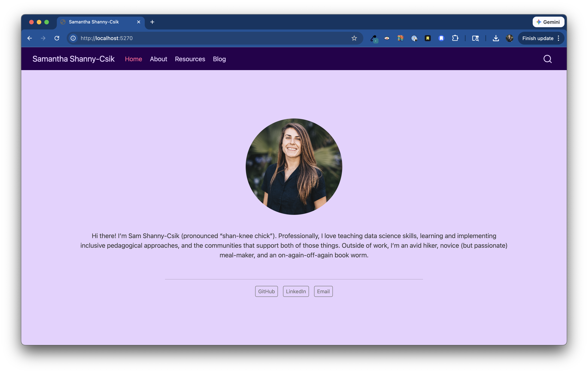

```{r}
#| eval: true 
#| echo: false
#| fig-align: "center"
#| out-width: "60%" 

```

::: {.center-text .small-text .gray-italic}
An example Quarto website that we'll practice building together.
:::

::: {.center-text}
[ materials](https://samanthacsik.github.io/RLadiesSB-quarto-websites/){.btn role="button" target="_blank"} [ source code](https://github.com/samanthacsik/RLadiesSB-quarto-websites){.btn role="button" target="_blank"} 
:::

## Abstract

A personal website is a great way to showcase your data science skills, highlight projects, and share what you’re passionate about. In this workshop, we’ll learn to build a personal website using Quarto, an accessible and flexible publishing framework, to help you get started. Together, we’ll:

- Build the core components of a Quarto website
- Add a blog to share your work and projects
- Use Sass to customize colors and fonts
- Walk through deploying your website ~for free~ using GitHub Pages

Whether you’re just getting started or looking for a Quarto refresher, this workshop will provide you with the tools you need to share your work with an online audience.

## Audience

This workshop was developed for the May 2026 [RLadies+ Santa Barbara](https://www.meetup.com/rladies-santa-barbara/){target="_blank"} Meetup, and was adapted from content originally developed for the [Master of Environmental Data Science](https://bren.ucsb.edu/masters-programs/master-environmental-data-science){target="_blank"} (MEDS) program at the [Bren School of Environmental Science & Management](https://bren.ucsb.edu/){target="_blank"}.
