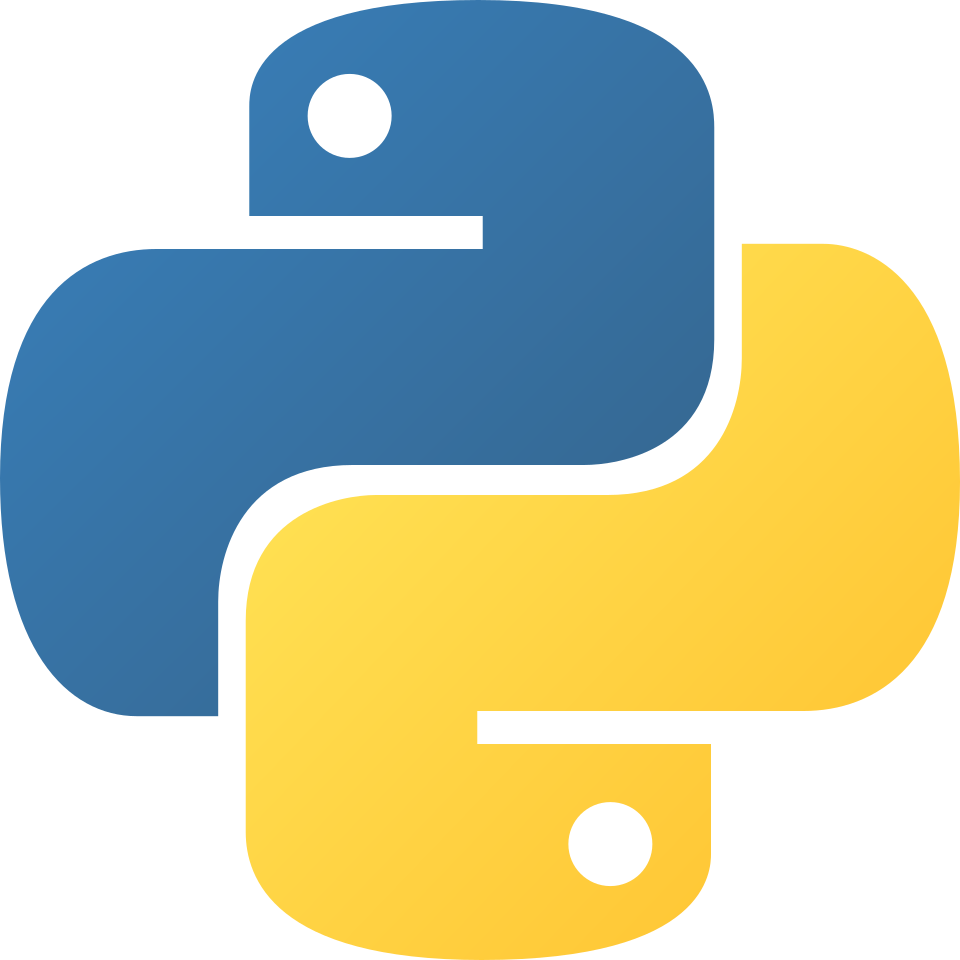

```{r}
#| eval: true 
#| echo: false
#| fig-align: "center"
#| out-width: "20%" 

```

::: {.center-text .small-text .gray-italic}
The Python logo
:::

::: {.center-text}
[ materials](https://ucsb-meds.github.io/intro-to-python/){.btn role="button" target="_blank"} [ source code](https://github.com/UCSB-MEDS/intro-to-python){.btn role="button" target="_blank"} 
:::

## Description

Setting up your computer is oftentimes one of the biggest hurdles to starting your Python programming journey. In this intro workshop, we'll discuss important terminology, concepts and tools, and learn how to set up our machines to begin programming in Python.

## Audience

This workshop was developed primarily for Bren MESM and PhD students looking to get statrted wtih Python on their own computers, though we imagine they may be helpful for anyone looking to dip their toes into the Python programming world!

